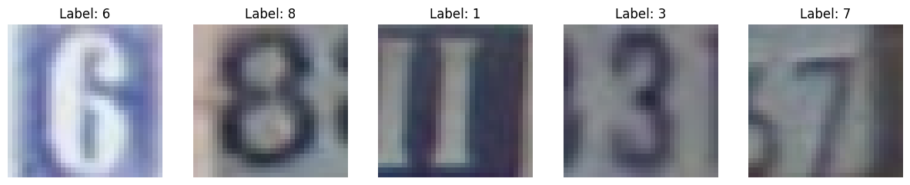
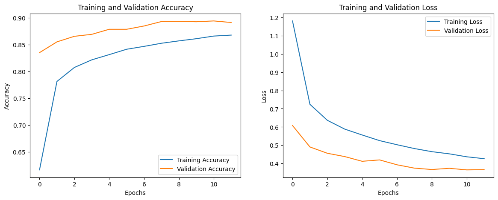
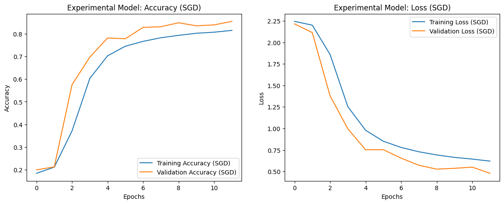
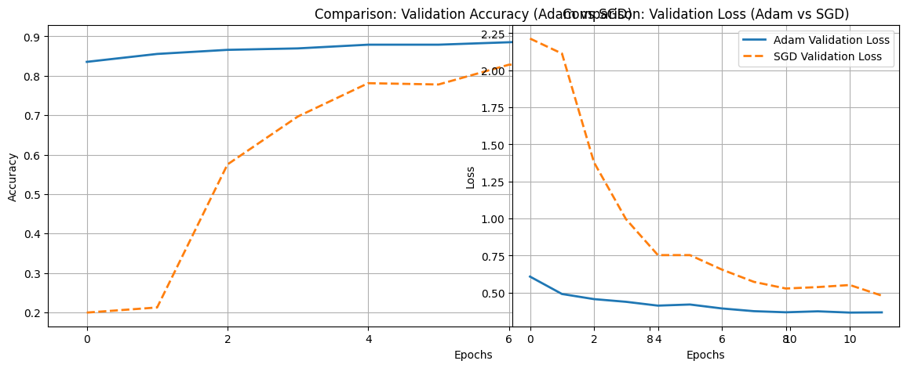

# SVHN Digit Recognition with CNNs

A Jupyter notebook that builds and trains Convolutional Neural Networks to classify street-view house number digits (0–9) from the SVHN dataset, comparing Adam vs SGD optimizers across 12 epochs.

## Dataset

**SVHN — Street View House Numbers** (Stanford / Google Street View)

| Split | Samples | Shape |
|---|---|---|
| Training (90 %) | ~66,000 | 32 × 32 × 3 |
| Validation (10 %) | ~7,300 | 32 × 32 × 3 |
| Test | ~26,000 | 32 × 32 × 3 |

- 10 classes: digits **0 – 9**
- RGB images, 32 × 32 pixels
- Label quirk: digit `0` is stored as `10` in the `.mat` file → corrected during loading

## Preprocessing

- Pixel values normalized from `[0, 255]` → `[0.0, 1.0]`
- Array transposed from MATLAB format `(H, W, C, N)` → TensorFlow format `(N, H, W, C)`
- 90/10 stratified train/validation split from the official training set

## CNN Architecture

```
Input (32, 32, 3)
 └─ Conv2D(32, 3×3, ReLU)
 └─ MaxPooling2D(2×2)
 └─ Conv2D(64, 3×3, ReLU)
 └─ MaxPooling2D(2×2)
 └─ Flatten
 └─ Dense(128, ReLU)
 └─ Dropout(0.5)
 └─ Dense(10, Softmax)
```

**Total parameters:** 315,722 (~1.20 MB)

| Choice | Rationale |
|---|---|
| 32 → 64 filters | Pyramidal learning: low-level edges first, complex features deeper |
| 3 × 3 kernels | Industry standard for small images; captures local spatial structure |
| ReLU | Avoids vanishing gradients; computationally efficient |
| Dropout 0.5 | Regularization — prevents overfitting by dropping 50 % of neurons during training |
| Softmax output | Converts logits to probability distribution across 10 classes |

## Training

| Setting | Baseline | Experimental |
|---|---|---|
| Optimizer | **Adam** | SGD |
| Loss | Sparse Categorical Crossentropy | Sparse Categorical Crossentropy |
| Epochs | 12 | 12 |
| Batch size | 64 | 64 |
| Best Val Accuracy | **89.45 %** | 85.46 % |

## Results

| Epoch | Adam Val Acc | SGD Val Acc |
|---|---|---|
| 1 | 83.5 % | 20.0 % |
| 4 | 86.9 % | 69.7 % |
| 8 | 89.3 % | 83.1 % |
| 12 | 89.2 % | 85.5 % |

**Adam** converges immediately and consistently outperforms SGD throughout all 12 epochs. SGD requires several epochs to "warm up" due to its fixed learning rate, and peaks ~4 % below Adam within the same epoch budget.

## Visualizations

### Sample SVHN Images



> Five random training samples showing the challenge of SVHN — background digits and varying contrast make classification harder than clean datasets like MNIST.

### Adam Optimizer — Training & Validation Curves



> Validation accuracy (orange) consistently stays above training accuracy throughout all 12 epochs — a direct result of Dropout(0.5) handicapping training while validation runs at full capacity. Final validation accuracy: **89.45 %**.

### SGD Optimizer — Training & Validation Curves



> SGD starts slowly (epoch 1: ~20 % val accuracy) due to its fixed learning rate, then climbs steeply. Both curves converge closely by epoch 12, reaching **85.46 %** — lower than Adam within the same epoch budget.

### Adam vs SGD — Comparison



> Adam (solid) vs SGD (dashed). Adam reaches ~84 % validation accuracy immediately at epoch 1 while SGD is still near random. The ~4 % accuracy gap and significantly higher SGD loss in early epochs demonstrate Adam's adaptive learning rate advantage.

## Key Findings

1. **No overfitting** — validation accuracy consistently exceeds training accuracy due to Dropout(0.5) handicapping the model during training while validation runs at full capacity.
2. **Adam > SGD** for this task — adaptive per-weight learning rates allow Adam to navigate the loss landscape faster and more accurately than a fixed-rate SGD.
3. **CNN suitability** — preserving spatial structure via convolution is essential for SVHN; flattening directly (MLP) would destroy pixel neighbourhood relationships critical for digit shape recognition.
4. **SVHN-specific challenge** — background distractors (adjacent digits in street photos) make this harder than MNIST; the two-block CNN handles this well at 89.45 % test accuracy.

## Requirements

```bash
pip install numpy matplotlib scipy tensorflow scikit-learn
```

## Repository Structure

```
.
├── D_R_CNN.ipynb                    # Full notebook
├── README.md
└── images/
    ├── 01_sample_images.png
    ├── 02_adam_training_curves.png
    ├── 03_sgd_training_curves.png
    └── 04_adam_vs_sgd_comparison.png
```
